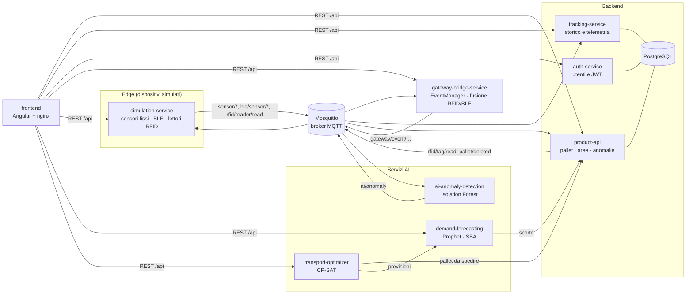

# Presentation — pagina web del progetto

> Componente **Presentation** del progetto **Smart Logistics IoT**: identificazione dei pallet, gestione delle aree
> di stoccaggio, monitoraggio dei carichi e moduli AI per un magazzino logistico.
> Project work del Corso di Perfezionamento 2025/2026, Università del Salento (IDALab) — autore: Calsolaro.
>
> Presentazione del progetto: <https://unisalento-idalab-corsoperfez-25-26.github.io/perfez-2526-presentation-calsolaro/>

## Il progetto

Il sistema segue un pallet lungo tutto il suo ciclo nel magazzino: **arrivo**, **identificazione**, **stoccaggio**
nell'area compatibile con la merce, **monitoraggio** durante la permanenza e il trasporto, **spedizione**.

- **Identificazione** dei pallet con tag **RFID** (lettori ai varchi e ai portali delle aree) e sensori **BLE** a bordo
  del carico; un *EventManager* fonde le due tecnologie e assegna a ogni evento un livello di confidenza.
- **Aree di stoccaggio** con regole per categoria: area refrigerata (0–8 °C), area sostanze critiche (gas e CO),
  magazzino generale.
- **Monitoraggio e anomalie**: sensori fissi di zona e sensori BLE del carico (temperatura, umidità, movimento,
  inclinazione); le anomalie seguono il ciclo DETECTED → ACKNOWLEDGED → RESOLVED.
- **Moduli AI**: valutazione delle anomalie con *Isolation Forest*, previsione della domanda con *Prophet* / *SBA*,
  assegnazione dei pallet ai camion con *CP-SAT* (OR-Tools).
- **Dashboard web** con tre ruoli (ADMIN, WAREHOUSE_MANAGER, SAFETY_OFFICER), storico degli accessi, piano dei
  trasporti e notifiche.

I dispositivi di campo (sensori fissi, BLE e lettori RFID) sono **simulati** da un servizio dedicato che pubblica sullo
stesso broker MQTT su cui pubblicherebbero i dispositivi reali.

## Architettura

Microservizi containerizzati su una rete Docker comune, coordinati a eventi tramite il broker **MQTT Mosquitto** e con
un database **PostgreSQL** condiviso dai servizi di backend. Il browser chiama un solo servizio per ogni operazione;
gli altri reagiscono agli eventi MQTT.



| Livello | Servizi | Tecnologie |
|---|---|---|
| Edge (simulato) | `simulation-service` | Python, FastAPI, paho-mqtt |
| Gateway | `gateway-bridge-service`, broker `mosquitto` | Java 21, Spring Boot 3.4, Eclipse Paho, Mosquitto 2 |
| Backend | `product-api`, `tracking-service`, `auth-service` | Java 21, Spring Boot 3.4/3.2, Spring Security (JWT), PostgreSQL 16 |
| AI | `ai-anomaly-detection`, `demand-forecasting`, `transport-optimizer` | Python, FastAPI, scikit-learn, Prophet, OR-Tools |
| Frontend | `frontend` | Angular 19, nginx (reverse proxy `/api/*`) |
| Deployment | `docker-compose.yml`, suite di validazione | Docker Compose, Python |

### Topic MQTT principali

| Topic | Da → A | Contenuto |
|---|---|---|
| `rfid/tag/read` | product-api → gateway, simulatore | evento ENTRY / MOVE / EXIT confermato dall'operatore |
| `rfid/reader/read` | simulatore → tracking | lettura del varco RFID attraversato |
| `ble/sensor/{detected,telemetry,alarm}` | simulatore → product-api, AI, gateway | rilevamento, telemetria e allarmi dei sensori BLE |
| `sensor/{temperature,humidity,gas,co}` | simulatore → AI, tracking | letture dei sensori fissi di zona |
| `gateway/event/…` | gateway → tracking | evento con confidenza e tecnologie usate |
| `ai/anomaly` | AI → product-api | anomalia di zona o valutazione AI (`aiScore`) |
| `pallet/deleted` | product-api → gateway, tracking | pulizia di coda e storico |

## Repository del progetto

| Componente | Repository | Contenuto |
|---|---|---|
| Edge Simulator | [perfez-2526-edge-simulator-calsolaro](https://github.com/UniSalento-IDALab-corsoPerfez-25-26/perfez-2526-edge-simulator-calsolaro) | Sensori fissi di zona, sensori BLE dei pallet, lettori RFID dei varchi (FastAPI) |
| Gateway | [perfez-2526-gateway-calsolaro](https://github.com/UniSalento-IDALab-corsoPerfez-25-26/perfez-2526-gateway-calsolaro) | EventManager con fusione RFID/BLE e coda di identificazione (Spring Boot), configurazione Mosquitto |
| Backend | [perfez-2526-backend-calsolaro](https://github.com/UniSalento-IDALab-corsoPerfez-25-26/perfez-2526-backend-calsolaro) | Pallet, aree e anomalie; storico e telemetria; utenti e JWT (Spring Boot, PostgreSQL) |
| AI Services | [perfez-2526-ai-services-calsolaro](https://github.com/UniSalento-IDALab-corsoPerfez-25-26/perfez-2526-ai-services-calsolaro) | Isolation Forest, Prophet/SBA, ottimizzazione CP-SAT (FastAPI) |
| Frontend | [perfez-2526-frontend-calsolaro](https://github.com/UniSalento-IDALab-corsoPerfez-25-26/perfez-2526-frontend-calsolaro) | Dashboard per ruolo, demo operative, nginx come reverse proxy |
| Deployment | [perfez-2526-deployment-calsolaro](https://github.com/UniSalento-IDALab-corsoPerfez-25-26/perfez-2526-deployment-calsolaro) | Avvio dell'intero sistema, smoke test e suite di validazione |
| **Presentation** (questo) | [perfez-2526-presentation-calsolaro](https://github.com/UniSalento-IDALab-corsoPerfez-25-26/perfez-2526-presentation-calsolaro) | GitHub Page di presentazione del progetto |

Per eseguire l'intero sistema servono tutti i repository clonati **nella stessa cartella**: le istruzioni sono nel
repository [deployment](https://github.com/UniSalento-IDALab-corsoPerfez-25-26/perfez-2526-deployment-calsolaro).

---

## Questo repository: Presentation

Il **repository di presentazione** del progetto, pubblicato con **GitHub Pages**:
<https://unisalento-idalab-corsoperfez-25-26.github.io/perfez-2526-presentation-calsolaro/>

La pagina è un sito statico, senza framework né build:

| File | Contenuto |
|---|---|
| `index.html` | Pagina di presentazione: obiettivi, architettura, componenti, funzionalità, video dimostrativi |
| `style.css` | Stile della pagina |
| `assets/img/` | Figure e schermate dell'applicazione |
| `assets/video/` | Video dimostrativi dei flussi principali |

### Pubblicazione

*Settings → Pages → Build and deployment*: sorgente **Deploy from a branch**, branch `main`, cartella `/ (root)`.

### Anteprima locale

```bash
python -m http.server 8000    # poi aprire http://localhost:8000
```
